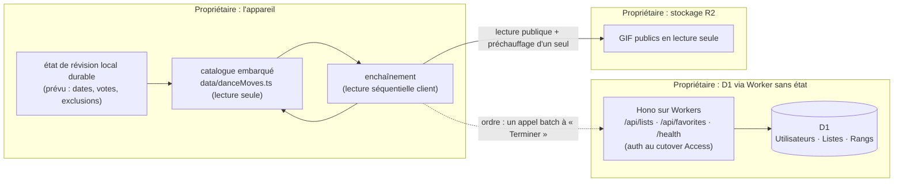
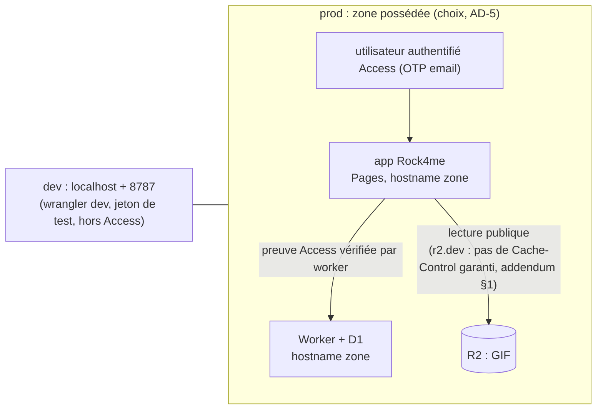
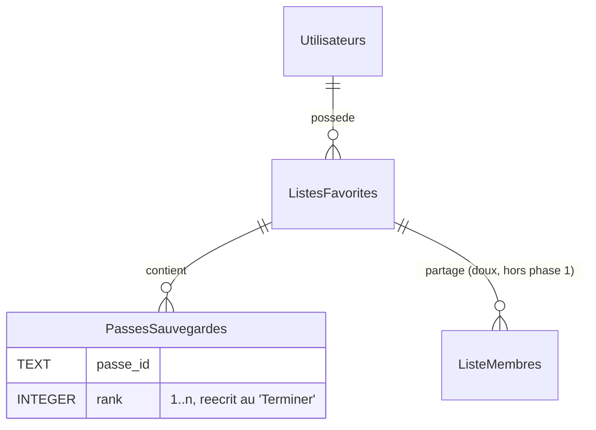

# Architecture Spine — Rock4me phase 1

## Design Paradigm

**Client riche hors-ligne d'abord + serveur sans état.** Chaque donnée a **un** propriétaire : le catalogue est un asset embarqué en lecture seule (propriétaire : le bundle) ; l'état de révision est local à l'appareil (propriétaire : l'appareil) ; les listes, favoris et l'ordre des passes sont en base (propriétaire : D1 via le Worker). Le Worker ne détient aucun état de session applicative : chaque requête porte sa preuve d'autorisation.



## Invariants & Rules

### AD-1 — Un propriétaire par donnée : appareil, bundle ou D1

- **Binds:** R1, R2, R4, R6, tous les écrans
- **Prevents:** deux propriétaires pour une même entité (liste, passe, état de vote — le conflit classique du hors-ligne contre le serveur)
- **Rule:** le catalogue et l'état de révision ne traversent jamais l'API en écriture ; les listes, leurs passes et leurs rangs ne vivent jamais en local comme source de vérité. Hors réseau, la révision continue avec ses données locales et les listes sont déclarées indisponibles — jamais réconciliées en tâche de fond en phase 1, et jamais mises en file automatique : une écriture de liste ratée se ressaie à la main quand le réseau revient. [ADOPTED — réalité du code : catalogue embarqué, file locale]

### AD-2 — D1 détient l'ordre des listes, par une seule famille d'écriture

- **Binds:** R4 (réordonnancement, enchaînement)
- **Prevents:** deux sources d'ordre qui divergent (`added_at` implicite contre un rang explicite), deux familles d'écriture sur la même table, écritures D1 hors réseau, un rang cassé dès le premier ajout
- **Rule:** l'ordre d'une liste = colonne `rank` (INTEGER) sur `PassesSauvegardes`, servie triée par le lecteur. **Toute** écriture sur cette table (insertion, suppression, réordonnancement) passe par la seule famille de routes `/api/lists/:id/passes*` dans `routes/lists.ts`, et maintient l'invariant dans la même transaction : l'insertion ajoute en fin à `MAX(rank)+1` ; la suppression compacte ; la réécriture de réordonnancement produit 1..n sans trou ; `UNIQUE(liste_id, passe_id)` en base reste. Le réordonnancement s'écrit en **un** appel batch idempotent — `PUT /api/lists/:id/passes/order`, rangs 1..n réécrits côté serveur — au bouton « Terminer » de l'écran de réordonnancement, unique point d'écriture du rang ; l'écran de fin d'enchaînement n'écrit jamais en D1. Hors réseau, « Terminer » est désactivé avec son explication, jamais mis en file. Une story qui doit écrire cette table consomme la story rang, elle n'en recrée pas le contrat ni un second fichier de migration. [decided 2026-10-28]

### AD-3 — L'enchaînement n'a pas de serveur, ni de brouillon qui fuit

- **Binds:** R4
- **Prevents:** un état de séquence côté serveur (table, websocket, enregistrement de session) pour une lecture purement locale ; une source d'ordre locale coexistante avec l'ordre D1
- **Rule:** l'enchaînement est la lecture séquentielle côté client d'une liste déjà lue via l'API, sur l'ordre lu du serveur à son lancement. Aucune table ni point de terminaison de séquence ne se crée. Le brouillon de réordonnancement reste **confiné à l'écran de réordonnancement** (jamais dans un contexte global ni dans les paramètres de l'enchaînement) ; tant qu'un brouillon non écrit existe, le lancement de l'enchaînement est bloqué — écrit ou abandonné, jamais fusionné. L'écriture d'ordre est idempotente, un seul appel en vol côté client, sémantique dernier-écrivain-gagne assumée pour l'utilisateur unique. Tout changement d'épic qui introduirait un état serveur de lecture obtient son AD propre, justifié. [decided 2026-10-28]

### AD-4 — Lecture média en lecture seule, poids assumé

- **Binds:** R6, C1, l'enchaînement
- **Prevents:** le chargement en rafale des N gestes d'une liste (16,8 Mo par GIF, ≈ 84 Mo pour cinq, addendum §1), toute écriture média en phase 1, un téléchargement répété du même geste
- **Rule:** les médias se lisent des URL publiques R2 déjà dans le catalogue, jamais écrites par le client ou l'API ; le cache-busting (`?t=…`) reste interdit. En navigation, aucun téléchargement de média avant la révélation ; pendant un enchaînement lancé explicitement, le préchauffage ne dépasse pas le geste suivant. Hors réseau, un geste déjà en cache se joue, jamais re-téléchargé (natif garanti, web au mieux) ; « Geste indisponible » est la dégradation, pas une erreur réseau. Le wifi assumé reste un compromis supporté (C1), pas exigence de performance ; si le critère R6 (« une fois par navigateur ») ne tient pas devant l'absence de `Cache-Control` de `r2.dev`, activer un domaine de zone pour les GIF dans l'épic R6 — pas à la fin du pipeline média. [decided 2026-10-28]

### AD-5 — Cloudflare Access est la seule autorité d'authentification

- **Binds:** R3, tout appel au Worker
- **Prevents:** deux systèmes de preuve coexistants, un écran de connexion dans l'app, une route qui saute la vérification
- **Rule:** le middleware Access est **global** dans `src/index.ts`, monté avant tout montage de route, aucune exception (`/health` est le point public vérifiable) ; chaque requête porte le JWT d'Access — l'en-tête `Cf-Access-Jwt-Assertion` de préférence, le cookie `CF_Authorization` en alternative — vérifié à chaque requête. Le JWT maison (délivrance, refresh, vérification) et le CORS maison (`CORS_ORIGIN`) sortent du chemin d'exécution dans la story de cutover (AD-6). Déconnexion = sortie de session Access (URL de l'application Access), pas un point de terminaison du Worker ; l'identité affichée se lit des réclamations du JWT Access. Les applications Access self-hosted exigent un hostname d'une zone possédée (documents 2026-04) ; la protection native d'un hostname `*.workers.dev` existe par ailleurs (documents du 12-10-2026) : la zone possédée reste choisie pour l'app et l'API — un seul point de vérification, les réglages CORS d'Access, une preuve unique — c'est un choix, pas une impossibilité. En dev local (`localhost:8787`), le middleware accepte un jeton de test signé par une variable d'environnement wrangler, jamais valable en production. [ADOPTED — brief C, confirmé par l'utilisateur 2026-10-28]

### AD-6 — Un seul cutover d'authentification

- **Binds:** R3, tous les épics qui précèdent Access
- **Prevents:** deux systèmes de preuve en cohabitation pendant des semaines, des stories qui investissent dans une voie promise à la suppression
- **Rule:** une et une seule story (dans l'épic Access) détient le retrait des routes `/api/auth/*`, du stockage de jeton, des écrans de connexion (`/app/login`, `app/(auth)/login.tsx`), des boutons de connexion de la landing, de l'attachement Bearer de `services/api.ts` et de `CORS_ORIGIN`. Jusqu'à ce cutover, les stories des épics précédents construisent sur la voie existante **sans l'étendre** : aucun nouveau stockage de jeton, aucun helper d'auth, aucun écran de compte. Le cutover se vérifie par `/health` (public) et une route protégée (401 sans preuve Access, 200 avec). [decided 2026-10-28]

### AD-7 — Une seule porte média

- **Binds:** R6, R4, les deux chemins de cache (web, natif)
- **Prevents:** deux chemins de chargement qui contredisent « une fois par navigateur » (préchargement hors du cache, cache interne d'un composant image qui double le cache fichier), un second module média
- **Rule:** toute lecture de geste (révélation, enchaînement, préchauffage, Rejouer) passe par le même module de cache `utils/gifCache.ts`, gardes `Platform.OS` conservées ; le préchauffage un-davance réchauffe ce même cache, jamais un second chemin. « À la révélation » = la montée à l'affichage est servie du cache ; le réchauffage n'est autorisé que pendant un enchaînement lancé explicitement, jamais en navigation. Une seule lecture en cours. La politique d'éviction native (plafond du cache fichier) se fixe dans la story R6, pour tenir « une fois par session » au Rejouer. [decided 2026-10-28]

### AD-8 — Phase 1 : le web est la surface authentifiée

- **Binds:** R3, R5, le déploiement natif
- **Prevents:** une app native sans preuve d'identité mute sur les listes, ou deux systèmes d'auth pour le natif
- **Rule:** phase 1 authentifie le build web (Pages + cookie/preuve Access). Les builds natifs, s'ils sont produits, restent hors périmètre d'authentification : catalogue et révision hors ligne seulement, listes déclarées indisponibles (AD-1), aucune route authentifiée appelée, aucun écran de connexion. R5 s'applique aux écrans qui existent sans introduire de chemin d'auth natif ; un porteur natif (jeton de service Access ou flux OTP en navigateur intégré) est un changement d'épic avec AD propre, justifié. [decided 2026-10-28]

## Consistency Conventions

| Concern | Convention |
| --- | --- |
| Naming (entités, fichiers, événements) | Schéma D1 en français/PascalCase (`ListesFavorites`, `PassesSauvegardes`, colonnes `nom_liste`, `rank`) ; code client en anglais, UI en français tutoiement ; la dette de nommage (`rock4you-api`, noms de buckets R2, logo) gardée jusqu'à migration délibérée |
| Data & formats | `passe_id` = identifiant TEXT du catalogue embarqué, unique juge de jouabilité (`hasGif`) : la révision ne propose jamais une passe sans geste, l'enchaînement la saute avec la mention, toute URL morte (une 404 mesurée, addendum §1) est sautée, jamais bloquante ; dates en TIMESTAMP UTC ; rangs réécrits 1..n sans trou à chaque écriture ; réponse d'erreur JSON `{ error: <message français> }` |
| State & cross-cutting (mutation, errors, auth, navigation) | État de révision (prévu : dates, votes, exclusions « geste indisponible ») persisté localement de façon durable et **survivant au redémarrage**, jamais mémoire seule, opaque au Worker ; la file du jour se dérive de cet état local (ancienneté + taux d'échec, addendum §5), plafonnée, sans ordonnanceur ; optimisme local borné : un affichage sans accusé serveur se déclare non enregistré (le rang), tout rechargement réadopte l'ordre D1 ; écritures de liste sans état portant leur preuve Access ; `EXPO_PUBLIC_API_URL` garde sa valeur actuelle jusqu'à la story de cutover, qui seule change l'environnement (dev et production) et reconstruit avec `--clear` ; session et enchaînement sont des routes plein écran hors `(tabs)`, profondeur de modale max 1, le retour natif quitte sans détruire l'état local |
| Identité sous Access | L'email du JWT Access identifie la ligne `Utilisateurs` (unique, pré-seeded) ; le provisionnement à la première connexion est la règle par défaut — la mécanique exacte se tranche au slicing |

## Stack

SEED — vérifié sur le code au 2026-10-28 ; le code possède ces choix dès qu'ils existent.

| Name | Version |
| --- | --- |
| Expo (React Native + web) — SDK 53, cinq générations derrière (SDK 58 au 15-10-2026) ; montée de version reportée, hors phase 1 | ^53.0.20 / React 19.0.0 / RN 0.79.1 |
| lucide-react-native | ^0.475.0 |
| Hono sur Workers | ^4.0.0 (+ `@hono/zod-validator` ^0.2.0) |
| Wrangler (déploiement, D1, migrations) | ^4.26.0 |
| Cloudflare Pages + Workers + Access (Zero Trust) — Pages en maintenance pour les nouveaux sites (« Start new projects with Workers », bandeau constaté 2026-10-28 sur la doc) : migration Workers static assets au prochain déploiement | plateforme en vigueur |
| Vitest — détenu, aucun test à ce jour ; `@cloudflare/workers-types` vieilli aussi | ^1.0.0 |

## Structural Seed

```text
rock4you/
  app/ components/ contexts/ services/   # client : écrans, providers (Auth global, Favoris global, Playlist sous les tabs), couche API
  data/                                   # catalogue embarqué, lecture seule à l'exécution
  utils/gifCache.ts                       # porte média unique : cache fichier natif + HTTP web, gardes Platform.OS (AD-7)
  worker/
    src/index.ts                          # Hono sans état : middleware Access global (AD-5), puis /api/lists /api/favorites /health ; les montages /api/auth/* maison sortent au cutover (AD-6)
    routes/lists.ts routes/moves.ts       # listes + passes (/passes, /moves) ; l'ordre vit dans routes/lists.ts (AD-2)
    migrations/*.sql                      # D1 : 0001 initial, 0002 avancé ; la migration de rang est un fichier, une story (AD-2)
```

Déploiement et environnements (l'enveloppe opérationnelle de cette altitude) :



Le modèle de données pertinent à cette altitude :



## Capability → Architecture Map

| Capability / Area | Lives in | Governed by |
| --- | --- | --- |
| R1 boucle de rappel | client (Réviser, session) + état local durable | AD-1, conventions State |
| R2 familles | catalogue embarqué (données) + UI client | AD-1, conventions Data |
| R3 Access sans compte | Access (Zero Trust) + middleware global Worker | AD-5, AD-6, AD-8 |
| R4 enchaînement + réordonnancement | client (lecture séquentielle) + `rank` D1 + appel batch idempotent | AD-2, AD-3 |
| R5 correctifs mobiles | UI client (cibles, safe areas, virtualisation), écrans qui existent | conventions, spines UX, AD-8 |
| R6 cache web | unique porte `utils/gifCache.ts` + R2 lecture | AD-4, AD-7 |

## Deferred

- Gel d'image pour la pause d'un GIF (web et natif diffèrent) : détail client, propre à la story d'enchaînement ; seuls le comportement (pause gèle l'image) et la porte AD-7 sont liés.
- Transport de la preuve Access dans un client natif (flux OTP en navigateur intégré, ou jeton de service) : deferred past phase 1 (AD-8) ; un second canal de preuve exigerait son AD propre.
- Migration des hostnames vers la zone possédée pour l'app et l'API (DNS, application Access, `EXPO_PUBLIC_API_URL`, cutover AD-6) : propre à l'épic Access.
- Question ouverte portée : quelle zone/domaine possédé porte l'app et l'API — à trancher dans l'épic Access.
- Dérivation média MP4/WebM + domaine R2 personnalisé : l'étape après la phase 1 ; en cas d'échec de R6 sur `r2.dev`, activer un domaine de zone pour les GIF dans l'épic R6 (AD-4).
- Réconciliation multi-appareils de l'état de révision : différée jusqu'à ce que la perte locale en gêne ; sync pas prévue en phase 1.
- SRS, historique et statistiques, partage public, notifications, miroir/ralenti/vue de dos : reportés au brief ; rien ne se construit pour.
- Dette des listes (plafond à 10 de `GET /api/lists`, chargement N+1, addendum §4) : question ouverte du ticket, à trancher au slicing ; l'épic enchaînement, qui lit une liste via l'API, la découvre de fait — si la dette entre en phase 1, elle entre dans la story propriétaire du contrat de lecture, jamais dans une story parallèle (AD-2).
- Données familles : 219 passes à classer à la main (risque « à moitié fait », brief) + niveau incohérent (interface 1–5, données 1–2) et tri de recherche inopérant (addendum §4) : propre à l'épic familles.
- Exploitation (logs Worker, sauvegarde D1, monitoring Access) : volontairement hors phase 1, en connaissance de cause.
- Montée de version Expo/RN (SDK 53 → 58) : hors phase 1.
- Ordonnancement des épics (boucle → familles → enchaînement → Access → correctifs) : hypothèse du brief, confirmée ou non au slicing de Sofia.
- Migration Pages → Workers static assets : au prochain déploiement, pas un chantier ; les deux hostnames basculent sur la zone possédée dans l'épic Access.